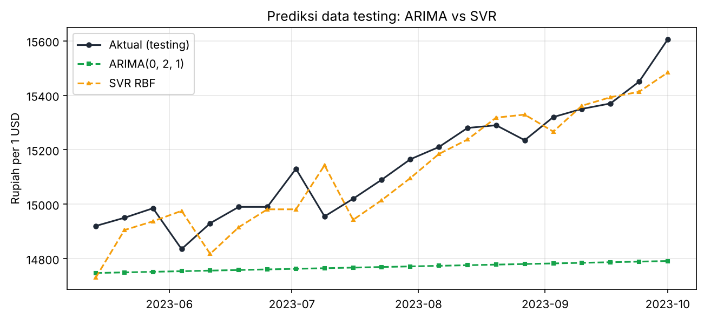
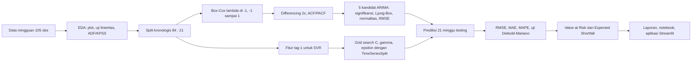
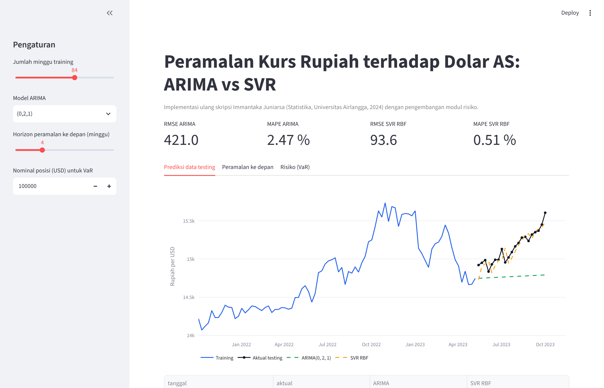

# Peramalan Kurs Rupiah terhadap Dolar AS: ARIMA vs SVR

Implementasi ulang skripsi S1 Statistika (Universitas Airlangga, 2024) dalam Python, lengkap dengan uji statistik pembanding model, modul Value at Risk, dan aplikasi interaktif.


## English summary

I compare ARIMA and Support Vector Regression for weekly IDR/USD forecasting using 105 observations. I reserve 21 weeks for chronological testing and tune SVR with time-series cross-validation. One-step RBF SVR achieves a MAPE of 0.509%, compared with 2.473% for ARIMA (0,2,1). Recursive SVR reaches 3.294%, so its one-step advantage does not extend to the full forecast horizon. I reproduce the analysis with `PYTHONPATH=src python -m kurs_forecast.pipeline` after installing the requirements.



## Daftar Isi

- [Latar Belakang dan Pertanyaan Analisis](#latar-belakang-dan-pertanyaan-analisis)
- [Dataset](#dataset)
- [Metodologi](#metodologi)
- [Hasil Utama](#hasil-utama)
- [Aplikasi Streamlit](#aplikasi-streamlit)
- [Struktur Folder](#struktur-folder)
- [Cara Menjalankan](#cara-menjalankan)
- [Teknologi yang Digunakan](#teknologi-yang-digunakan)
- [Keterbatasan dan Pengembangan Lanjutan](#keterbatasan-dan-pengembangan-lanjutan)
- [Lisensi](#lisensi)
- [Kontak](#kontak)

## Latar Belakang dan Pertanyaan Analisis

Sepanjang 2022 sampai 2023 The Fed menaikkan suku bunga berulang kali untuk menekan inflasi, dan rupiah melemah dari kisaran Rp14.000 ke Rp15.700 per dolar AS. Bagi perusahaan dengan kewajiban dalam dolar, pemerintah, maupun investor, kemampuan memperkirakan arah kurs beberapa minggu ke depan berpengaruh langsung pada keputusan lindung nilai dan anggaran.

Proyek ini menjawab empat pertanyaan:

1. Bagaimana karakteristik data kurs IDR/USD mingguan periode Oktober 2021 sampai Oktober 2023?
2. Seberapa akurat model klasik ARIMA memprediksi kurs?
3. Seberapa akurat model machine learning Support Vector Regression (SVR) memprediksi kurs?
4. Apakah perbedaan akurasi keduanya **signifikan secara statistik**, dan bagaimana hasilnya dipakai untuk mengukur risiko nilai tukar?

Pertanyaan 1 sampai 3 adalah rumusan masalah skripsi. Pertanyaan 4 (uji Diebold-Mariano dan Value at Risk) adalah pengembangan baru di repo ini.

## Dataset

| Aspek | Keterangan |
|---|---|
| Sumber | Kurs USD/IDR mingguan dari id.investing.com, ditranskripsi dari Lampiran 1 skripsi |
| Periode | 3 Oktober 2021 sampai 1 Oktober 2023 (105 minggu) |
| Pembagian | 84 minggu training (sampai 7 Mei 2023), 21 minggu testing |
| Rentang | Rp14.070 sampai Rp15.735 per USD |
| File | `data/raw/kurs_idr_usd_mingguan.csv` (kolom `index`, `tanggal`, `kurs`) |
| Pembaruan | `kurs_forecast.data.download_latest()` mengunduh data terbaru dari Yahoo Finance (ticker `IDR=X`) bila ingin mengulang analisis pada periode lain |

Transkripsi data diverifikasi dengan menghitung ulang nilai transformasi Box-Cox (1/kurs) dan mencocokkannya dengan Lampiran 4 skripsi; seluruh nilai sampel cocok sampai 6 angka signifikan.

## Metodologi



Perbedaan yang disengaja dari skripsi, beserta alasannya:

- **Lambda Box-Cox dibatasi pada [-1, 1]**, mengikuti default `forecast::BoxCox.lambda` di R yang dipakai skripsi. Tanpa batas, MLE scipy menghasilkan lambda sekitar -7 yang membuat deret praktis konstan.
- **Deret hasil Box-Cox distandardisasi** sebelum estimasi ARIMA. Nilai 1/kurs berorde 1e-5 (sigma kuadrat skripsi 3e-13) dan membuat optimizer tidak stabil; standardisasi adalah transformasi affine sehingga tidak mengubah model.
- **Tuning SVR memakai validasi silang runtun waktu** (`TimeSeriesSplit`), bukan data testing, supaya angka akurasi testing benar-benar out-of-sample.
- **Target SVR distandardisasi** agar grid epsilon 0 sampai 1 bermakna pada skala rupiah.
- **Dua skema prediksi SVR dilaporkan**: satu langkah ke depan (seperti skripsi) dan rekursif, karena keduanya menjawab kebutuhan bisnis yang berbeda.

## Hasil Utama

Semua angka di bawah berasal dari `reports/hasil.json` yang dihasilkan `python -m kurs_forecast.pipeline`, bukan ditulis tangan.

### Karakteristik data

| Uji | Hasil | Keputusan |
|---|---|---|
| Nonlinieritas (regresi Volterra, padanan uji Terasvirta) | F = 2,99, p = 0,055 | Indikasi nonlinier di batas 5% (skripsi: chi-kuadrat 6,10, p = 0,047) |
| ADF pada level | p = 0,516 | Tidak stasioner |
| KPSS pada level | p = 0,010 | Tidak stasioner |
| ADF setelah Box-Cox dan differencing 2 | p < 0,001 | Stasioner |
| KPSS setelah differencing 2 | p = 0,100 | Stasioner |
| Lambda Box-Cox (training) | -1,0000 | Transformasi 1/kurs, sama dengan skripsi (-0,9999) |

### Seleksi model ARIMA (mereplikasi Tabel 4.1 skripsi)

| Model | Parameter | Semua signifikan | White noise | RMSE training | MAPE training |
|---|---|---|---|---|---|
| **ARIMA (0,2,1)** | MA(1) = -0,9835 | Ya | Ya | **129,40** | **0,646 %** |
| ARIMA (1,2,0) | AR(1) = -0,6057 | Ya | Ya | 147,23 | 0,763 % |
| ARIMA (2,2,0) | AR(1) = -0,8058, AR(2) = -0,3203 | Ya | Ya | 139,13 | 0,722 % |
| ARIMA (1,2,1) | AR(1) = -0,0983 (p = 0,41) | Tidak | Ya | 129,01 | 0,642 % |
| ARIMA (2,2,1) | AR(1), AR(2) tidak signifikan | Tidak | Ya | 127,37 | 0,639 % |

Koefisien yang diperoleh identik dengan skripsi sampai tiga desimal (skripsi: MA(1) = -0,98277; AR(1) = -0,60566; AR(1), AR(2) = -0,80580, -0,32028). Residual ARIMA (0,2,1) white noise pada lag 12, 24, 36, 48 (p = 0,69; 0,81; 0,60; 0,80) dan normal menurut Kolmogorov-Smirnov (p = 0,553), walau Shapiro-Wilk berada di batas (p = 0,040).

### Akurasi pada 21 minggu data testing

| Model | Hyperparameter | RMSE | MAE | MAPE |
|---|---|---|---|---|
| ARIMA (0,2,1) | MA(1) = -0,9835 | 421,05 | 377,02 | 2,473 % |
| SVR polynomial | C = 2, gamma = 0,125, epsilon = 0,5 | 413,37 | 390,93 | 2,570 % |
| **SVR RBF** (satu langkah) | C = 512, gamma = 0,125, epsilon = 0,3 | **93,60** | **76,87** | **0,509 %** |
| SVR RBF (rekursif 21 langkah) | sama | 554,63 | 501,89 | 3,294 % |
| *Pembanding skripsi: ARIMA (0,2,1)* | | *425,40* | | *2,49 %* |
| *Pembanding skripsi: SVR RBF* | *C = 16, gamma = 1, epsilon = 0,1* | *93,65* | | *0,539 %* |

### Insight

1. **SVR kernel RBF mengungguli ARIMA secara signifikan.** Uji Diebold-Mariano (koreksi Harvey-Leybourne-Newbold) menghasilkan statistik -4,55 dengan p = 0,0002, sehingga selisih akurasi bukan kebetulan sampel.
2. **ARIMA (0,2,1) menghasilkan proyeksi hampir datar** di sekitar Rp14.750 sementara kurs aktual naik ke Rp15.605. Model linier dengan differencing dua kali hanya mewariskan tren lokal terakhir, sama seperti temuan skripsi.
3. **Keunggulan SVR hanya berlaku untuk horizon satu minggu.** Jika dipaksa meramal 21 minggu tanpa data aktual (rekursif), MAPE naik ke 3,29 %, lebih buruk daripada ARIMA. Pemilihan model harus mengikuti horizon kebutuhan bisnis.
4. **Risiko nilai tukar mingguan:** dari 104 log return (rata-rata 0,09 %, simpangan baku 0,79 %), VaR 95 % historis sebesar 1,19 % dan parametrik 1,40 %, dengan Expected Shortfall 1,41 %. Untuk kewajiban 100.000 USD pada kurs Rp15.605, kerugian mingguan terburuk pada keyakinan 95 % sekitar Rp18,7 juta (historis) dan rata-rata kerugian saat melewati batas itu Rp22,2 juta.

Laporan lengkap: [`reports/laporan_analisis.md`](reports/laporan_analisis.md).

## Aplikasi Streamlit



Aplikasi memungkinkan pengguna mengubah jumlah minggu training, memilih model ARIMA, menentukan horizon peramalan, dan menghitung VaR untuk nominal posisi tertentu. Jalankan dengan `streamlit run app/streamlit_app.py`.

## Demo

Tautan demo akan ditambahkan setelah deploy.

## Struktur Folder

```
forecast-kurs-rupiah-arima-svr/
├── app/streamlit_app.py            # aplikasi interaktif
├── assets/                         # gambar hasil pipeline (dipakai README dan laporan)
├── data/
│   ├── raw/kurs_idr_usd_mingguan.csv
│   └── processed/prediksi_testing.csv
├── docs/
│   ├── kamus_data.md
│   └── metodologi.md
├── notebooks/
│   ├── buat_notebook.py            # membangun dan mengeksekusi notebook secara terprogram
│   ├── 01_eda.ipynb
│   ├── 02_pemodelan_arima.ipynb
│   ├── 03_pemodelan_svr.ipynb
│   └── 04_perbandingan_dan_risiko.ipynb
├── reports/
│   ├── hasil.json                  # seluruh angka hasil (sumber kebenaran README)
│   ├── laporan_analisis.md
│   └── tabel_kandidat_arima.csv
├── src/kurs_forecast/              # paket Python: data, transform, diagnostics, models, metrics, risk, plots, pipeline
├── tests/                          # 16 unit test (pytest)
├── .github/workflows/ci.yml        # ruff + pytest + smoke test pipeline
├── Makefile, requirements.txt, environment.yml, pyproject.toml
└── README.md, LICENSE, CONTRIBUTING.md, CHANGELOG.md
```

## Cara Menjalankan

```bash
git clone https://github.com/imman20/forecast-kurs-rupiah-arima-svr.git
cd forecast-kurs-rupiah-arima-svr
python -m venv .venv && source .venv/bin/activate   # Windows: .venv\Scripts\activate
pip install -r requirements-dev.txt
```

Menjalankan seluruh pipeline (sekitar 1 sampai 2 menit, grid search SVR 770 kombinasi):

```bash
PYTHONPATH=src python -m kurs_forecast.pipeline
```

Menjalankan unit test dan lint:

```bash
python -m pytest -q
ruff check src tests app
```

Membangun ulang notebook beserta outputnya:

```bash
python notebooks/buat_notebook.py
```

Menjalankan aplikasi:

```bash
streamlit run app/streamlit_app.py
```

Atau cukup `make all` untuk instalasi, lint, test, pipeline, dan notebook sekaligus.

## Teknologi yang Digunakan

| Kebutuhan | Tool |
|---|---|
| Pengolahan data | pandas, NumPy |
| ARIMA, uji ADF/KPSS/Ljung-Box | statsmodels |
| SVR, grid search, TimeSeriesSplit | scikit-learn |
| Box-Cox, uji normalitas, distribusi | SciPy |
| Visualisasi | matplotlib, Plotly |
| Aplikasi | Streamlit |
| Kualitas kode | pytest, ruff, GitHub Actions |

## Keterbatasan dan Pengembangan Lanjutan

- Data hanya 105 minggu dan satu periode makro tertentu (siklus kenaikan suku bunga). Hasil belum tentu berlaku saat rezim berbeda; fungsi `download_latest` disediakan untuk menguji ulang pada data terbaru.
- SVR hanya memakai satu fitur (lag-1). Penambahan variabel eksogen seperti suku bunga BI dan The Fed, harga minyak, atau indeks dolar berpotensi menaikkan akurasi, seperti disarankan Bab V skripsi.
- Uji nonlinieritas memakai padanan regresi Volterra, bukan uji Terasvirta berbasis jaringan saraf seperti di R, sehingga nilai statistiknya tidak identik.
- Pengembangan berikutnya: model ETS dan LSTM sebagai pembanding, interval prediksi untuk SVR lewat bootstrap, dan backtesting VaR (uji Kupiec).

## Lisensi

Proyek ini dilisensikan di bawah [MIT License](LICENSE).

## Kontak

Immantaka Juniarsa, S1 Statistika Universitas Airlangga.
GitHub [@imman20](https://github.com/imman20), email [immantakajuniarsa30@gmail.com](mailto:immantakajuniarsa30@gmail.com).
