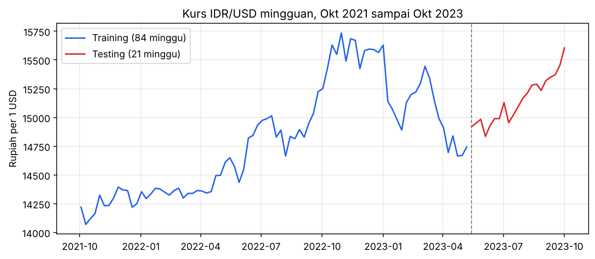
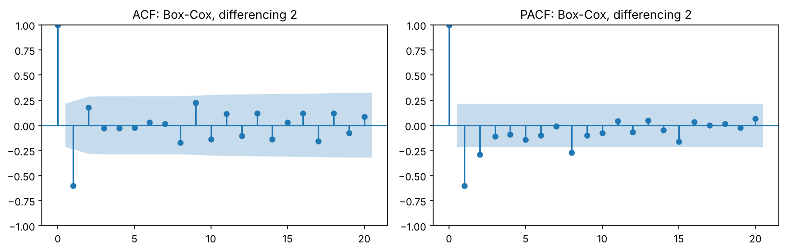
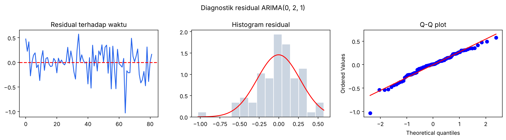
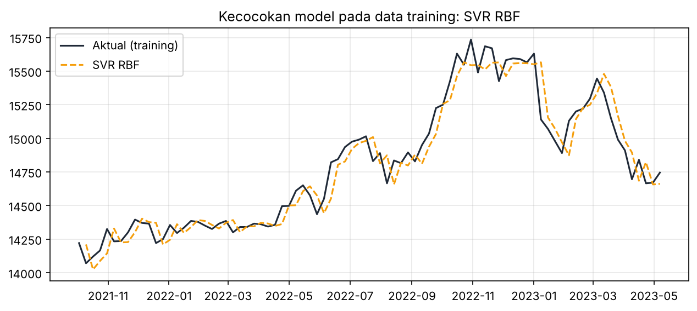
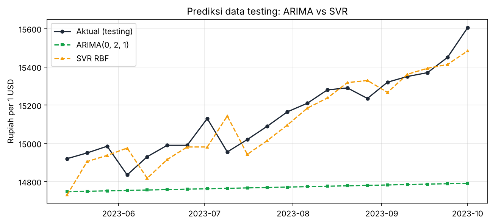
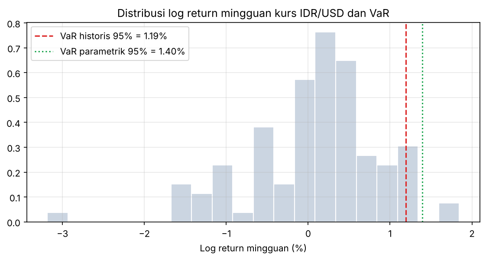

# Laporan Analisis: Peramalan Kurs IDR/USD dengan ARIMA dan SVR

Penulis: Immantaka Juniarsa. Sumber angka: `reports/hasil.json` hasil `python -m kurs_forecast.pipeline`.

## 1. Ringkasan eksekutif

- Pada 21 minggu data uji (Mei sampai Oktober 2023), SVR kernel RBF memprediksi kurs dengan MAPE 0,51 % (RMSE Rp93,6), sedangkan ARIMA (0,2,1) menghasilkan MAPE 2,47 % (RMSE Rp421,0).
- Uji Diebold-Mariano menyatakan perbedaan tersebut signifikan (statistik -4,55; p = 0,0002).
- Keunggulan SVR berlaku untuk peramalan satu minggu ke depan. Pada skema rekursif 21 minggu, MAPE SVR naik menjadi 3,29 %.
- Value at Risk 95 % satu minggu untuk pelemahan rupiah sebesar 1,19 % (historis) dan 1,40 % (parametrik); Expected Shortfall 1,41 %.

## 2. Data

105 observasi kurs USD/IDR mingguan, 3 Oktober 2021 sampai 1 Oktober 2023, dari Lampiran 1 skripsi (sumber asli id.investing.com). Nilai terendah Rp14.070 (10 Oktober 2021) dan tertinggi Rp15.735 (30 Oktober 2022). Data dibagi kronologis: 84 minggu training dan 21 minggu testing.

## 3. Karakteristik data

Uji nonlinieritas padanan Terasvirta (regresi Volterra pada lag-1) menghasilkan F = 2,99 dengan p = 0,055, berada di batas 5 %; skripsi dengan uji Terasvirta di R memperoleh p = 0,047. Keduanya mengindikasikan hubungan yang tidak sepenuhnya linier, yang menjadi dasar pemakaian kernel nonlinier pada SVR.

Uji stasioneritas pada data training:

| Deret | ADF p-value | KPSS p-value | Kesimpulan |
|---|---|---|---|
| Level | 0,516 | 0,010 | Tidak stasioner |
| Box-Cox, differencing 1 | < 0,001 | - | Stasioner menurut ADF |
| Box-Cox, differencing 2 | < 0,001 | 0,100 | Stasioner |

Lambda Box-Cox (MLE dengan batas [-1, 1]) sebesar -1,0000, sehingga transformasi yang dipakai adalah 1/kurs, sama dengan skripsi. Differencing dilakukan dua kali mengikuti skripsi karena pada differencing pertama ACF dan PACF tidak memiliki lag yang keluar dari batas signifikansi, sehingga tidak ada orde AR/MA yang bisa diidentifikasi.

## 4. Pemodelan ARIMA

Lima kandidat dari plot ACF/PACF (ACF memotong di lag 1, PACF di lag 1 sampai 2):

| Model | Parameter | p-value | White noise (LB 12/24/36/48) | RMSE train | MAPE train |
|---|---|---|---|---|---|
| ARIMA (0,2,1) | MA(1) = -0,9835 | < 0,001 | 0,69 / 0,81 / 0,60 / 0,80 | 129,40 | 0,646 % |
| ARIMA (1,2,0) | AR(1) = -0,6057 | < 0,001 | Ya | 147,23 | 0,763 % |
| ARIMA (2,2,0) | AR(1) = -0,8058; AR(2) = -0,3203 | < 0,01 | Ya | 139,13 | 0,722 % |
| ARIMA (1,2,1) | AR(1) = -0,0983; MA(1) = -0,9639 | AR(1) p = 0,41 | Ya | 129,01 | 0,642 % |
| ARIMA (2,2,1) | AR(1) = -0,0656; AR(2) = 0,1552; MA(1) = -0,9982 | AR tidak signifikan | Ya | 127,37 | 0,639 % |

ARIMA (0,2,1) terpilih: seluruh parameter signifikan, residual white noise, normal menurut Kolmogorov-Smirnov (p = 0,553), dan RMSE training terkecil di antara model yang layak. Uji Shapiro-Wilk memberi p = 0,040, sedikit di bawah 5 %, yang menunjukkan ekor residual agak tebal; hal ini wajar pada data kurs dan tidak mengubah keputusan model.

Persamaan model pada skala transformasi: Z*_t = 2 Z*_{t-1} - Z*_{t-2} + a_t - 0,9835 a_{t-1}, dengan Z* = 1/kurs.

Akurasi testing: RMSE 421,05; MAE 377,02; MAPE 2,473 % (skripsi: 425,40 dan 2,49 %).

## 5. Pemodelan SVR

Input: lag-1 kurs (PACF hanya signifikan di lag 1). Grid: C = 2^0 sampai 2^9, gamma = 2^-3 sampai 2^3, epsilon = 0 sampai 1 langkah 0,1 (770 kombinasi), dievaluasi dengan TimeSeriesSplit 5 lipatan.

| Kernel | Parameter terbaik | RMSE CV | RMSE train | MAPE train | RMSE test | MAPE test |
|---|---|---|---|---|---|---|
| RBF | C = 512; gamma = 0,125; epsilon = 0,3 | 176,2 | 118,49 | 0,616 % | 93,60 | 0,509 % |
| Polynomial (derajat 2) | C = 2; gamma = 0,125; epsilon = 0,5 | 312,5 | 436,27 | 2,605 % | 413,37 | 2,570 % |

Kernel RBF jauh lebih baik, konsisten dengan skripsi (RBF 0,539 % vs polynomial 2,125 %). Parameter terbaik berbeda dari skripsi (C = 16, gamma = 1, epsilon = 0,1) karena target distandardisasi dan skema validasinya berbeda, tetapi akurasi testing praktis sama.

Skema rekursif (prediksi dipakai sebagai input berikutnya) untuk 21 minggu memberi RMSE 554,63 dan MAPE 3,294 %. Angka ini penting disampaikan karena akurasi 0,5 % sering disalahartikan sebagai akurasi peramalan jangka panjang.

## 6. Perbandingan dan uji signifikansi

Uji Diebold-Mariano dengan koreksi Harvey-Leybourne-Newbold pada galat kuadrat (h = 1): statistik -4,546, p = 0,0002. H0 (akurasi sama) ditolak; SVR RBF lebih akurat secara statistik, bukan sekadar lebih kecil RMSE-nya.

## 7. Analisis risiko nilai tukar

Dari 104 log return mingguan (rata-rata 0,089 %, simpangan baku 0,795 %):

| Ukuran (alpha = 5 %) | Persen | Rupiah untuk posisi 100.000 USD pada kurs Rp15.605 |
|---|---|---|
| VaR historis | 1,19 % | Rp18.731.372 |
| VaR parametrik (normal) | 1,40 % | Rp21.945.358 |
| Expected Shortfall historis | 1,41 % | Rp22.177.383 |

Interpretasi: dalam satu minggu, dengan keyakinan 95 %, pelemahan rupiah tidak akan melebihi sekitar 1,2 sampai 1,4 %. Jika batas itu terlampaui, rata-rata kerugiannya sekitar 1,4 %. Tim treasury dapat memakai angka ini untuk menentukan besaran lindung nilai mingguan.

## 8. Kesimpulan dan rekomendasi

1. SVR kernel RBF adalah model terbaik untuk peramalan satu minggu ke depan, dengan keunggulan yang signifikan secara statistik atas ARIMA (0,2,1).
2. Untuk horizon lebih dari beberapa minggu, kedua model sama-sama lemah; diperlukan variabel eksogen (suku bunga BI dan The Fed, indeks dolar) atau model yang memodelkan rezim.
3. Untuk pengelolaan risiko, VaR historis mingguan 1,2 % dapat dijadikan dasar cadangan atau rasio lindung nilai, dengan Expected Shortfall sebagai penyangga saat kondisi ekstrem.
